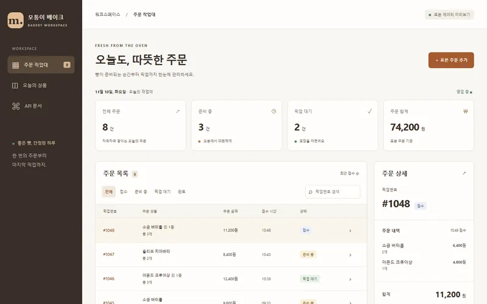
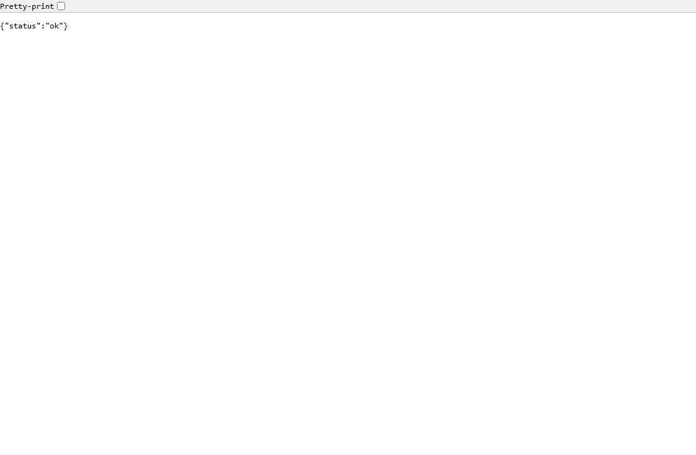

# 모퉁이 베이크 · 주문 접수 API

가상 동네 빵집의 주문 접수, 재고 차감, 준비·픽업 상태 변경을 보여 주는 샘플입니다.
PostgreSQL에 주문을 저장하고 MongoDB에 이력을 남기며 Redis로 상품 목록을 캐시합니다.
관리 화면 미리보기와 API 문서는 표본 JSON으로 동작하며 개인정보를 입력받지 않습니다.

## 보는 주소

Pages 공개 예정 주소: https://junetapa-juncheol.github.io/sample-order-api/

GitHub에 올린 뒤 Settings → Pages → Deploy from a branch → main /docs를 선택합니다.
`docs/`는 빌드 결과이며 `/sample-order-api/` 하위 경로를 기준으로 구성했습니다.
Pages의 작업대는 정적 미리보기입니다. 표본 주문 추가·검색·상태 필터·상세·상태 변경·응답 복사를 체험할 수 있습니다.
새로고침하면 표본 상태로 돌아옵니다. 실제 API는 아래 로컬 실행에서 별도로 호출합니다.



## 쓴 기술

| 기술 | 쓴 곳 |
| --- | --- |
| Node.js · Express | `src/server.js`, `src/app.js` REST API |
| PostgreSQL | `migrations/schema.sql`, `src/migrate.js`, 주문·상품·재고·outbox 트랜잭션 |
| MongoDB | `src/connections.js`, `src/outbox.js`의 `order_events` 컬렉션과 고유 이벤트 인덱스 |
| Redis | `src/app.js`의 상품 캐시, TTL 30초, 주문 후 무효화 |
| Nodemailer · SMTP | `src/mail.js` 루프백 SMTP 수신함. 메시지 원문은 보관하지 않음 |
| Nginx | `nginx/default.conf`의 `/api/` 리버스 프록시와 정적 문서 |
| Docker · Compose | `Dockerfile`, `docker-compose.yml`의 5개 서비스와 상태 검사 |
| Jest · Supertest | `tests/api.test.js` 실제 서비스 연결 통합 테스트 |
| GitHub Actions | `.github/workflows/ci.yml`의 PostgreSQL·MongoDB·Redis 서비스 컨테이너 |
| Vite | `web/` 소스 → `docs/` 정적 문서 빌드 |

## 실행 방법

Node.js 22 이상과 Docker Compose v2가 필요합니다. 이 구성은 로컬 학습용이며 데이터베이스 인증은 내부 개발망에서만 생략합니다.
컨테이너 데이터베이스 포트는 호스트에 공개하지 않고 Nginx만 `127.0.0.1:8080`에 연결합니다.

```sh
npm ci
npm run lint
npm run build
docker compose up --build -d
```

- 관리 미리보기: http://localhost:8080/sample-order-api/
- API 상태 검사: http://localhost:8080/api/health
- 중지: `docker compose down` (이름 있는 데이터 볼륨은 유지)

```sh
curl http://localhost:8080/api/products
curl -X POST http://localhost:8080/api/orders \
  -H 'Content-Type: application/json' \
  -H 'Idempotency-Key: local-order-001' \
  -d '{"items":[{"productId":1,"quantity":2}]}'
```

서버를 Node.js로 직접 실행할 때는 PostgreSQL·MongoDB·Redis를 먼저 실행합니다.
접속 환경 변수는 `DATABASE_URL`, `MONGO_URL`, `REDIS_URL`이며 기본값은 `src/connections.js`에 있습니다.
`npm start`가 마이그레이션을 적용합니다. 별도 적용은 `npm run migrate`입니다.
SQL 초기 상품은 다시 실행해도 중복되지 않습니다.

## API

| 메서드 · 경로 | 동작 |
| --- | --- |
| `GET /api/health` | 세 데이터 저장소 검사, 정상 200 · 장애 503 |
| `GET /api/products` | 상품·재고, `X-Cache: MISS/HIT/BYPASS` |
| `GET /api/pickup-days?month=2026-12` | 공휴일·주말을 제외한 픽업 가능일 |
| `GET /api/orders` | 최근 주문 최대 100개 |
| `POST /api/orders` | 주문 접수, 최초 201 · 같은 요청 재전송 200 |
| `PATCH /api/orders/:id/status` | `{ "status": "preparing" }` 등 다음 단계로 변경 |
| `GET /api/orders/:id/history` | MongoDB 주문 이력 |

상태는 `received → preparing → ready → collected` 순입니다.
누락·잘못된 수량·추가 필드는 400, 없는 상품·주문은 404, 재고 부족·잘못된 상태 전이는 409입니다.
`Idempotency-Key`는 영문·숫자·밑줄·하이픈 8~80자이며, 같은 키에 다른 주문을 보내면 409입니다.
상품 ID 순으로 행을 잠그고 트랜잭션에서 재고를 차감합니다.
같은 키의 동시 요청은 PostgreSQL advisory lock으로 직렬 처리합니다.

주문과 outbox는 하나의 SQL 트랜잭션에 저장합니다. MongoDB·SMTP 실패 시 주문을 유지하고 5초마다 재시도합니다.
MongoDB 기록은 이벤트 ID로 중복을 막습니다. SMTP는 재시도 구간에서 같은 메시지를 다시 받을 수 있습니다.
이 샘플은 인증·결제·실제 메일 발송을 포함하지 않습니다.
메일은 **127.0.0.1에 바인딩한 가짜 SMTP로만** 전달하며 외부 SMTP 설정이나 API 키를 받지 않습니다.


## 한국 공공 API 연동(목업 기본)

한국천문연구원 특일정보의 공휴일 조회를 픽업 일정에 연결했습니다.
`GET /api/pickup-days?month=2026-12`는 월별 날짜와 `available`, 휴무 `reason`, `mode`를 반환합니다.
이 샘플의 영업 규칙은 공휴일과 토·일요일 휴무입니다.

주문에 `"pickupDate":"2026-12-25"`를 넣으면 휴무일은 409와 `nextAvailableDate`로 거절합니다.
예를 들어 2026-12-25의 다음 픽업 가능일은 2026-12-28입니다.
가능한 날짜는 주문·이력에 저장하고, 같은 요청 키로 날짜를 바꾸면 409입니다.
기존 호출과의 호환을 위해 날짜 생략은 허용하며 `pickupDate:null`로 저장합니다.
저장한 주문의 같은 요청 재전송은 공휴일 서비스 장애 중에도 기존 결과를 반환합니다.

키가 없거나 빈 값이면 외부 호출 없이 `fixtures/01_holidays.json`을 사용합니다.
표본은 **2026-11, 2026-12, 2027-01** 세 달만 포함하며, 다른 달은 503입니다.
표본을 실제 공휴일 전체 목록으로 보장하지 않습니다. Pages도 같은 표본으로 픽업 가능일을 표시합니다.

실제 조회는 사람이 [공공데이터포털의 한국천문연구원 특일정보](https://www.data.go.kr/tcs/dss/selectApiDataDetailView.do?publicDataPk=15012690)에서 활용신청 후 키를 직접 발급받아 설정합니다.
`.env.example`의 `DATA_GO_KR_SERVICE_KEY`는 빈 칸이며, **일반 인증키(Decoding)**를 환경변수에 설정하면 `live`로 전환됩니다.
키는 서버에만 설정합니다. 웹 소스·정적 문서에는 넣지 않습니다.
셸에 환경변수를 설정한 뒤 `npm start`로 실행하거나, 로컬 `.env`에 설정 후 `node --env-file=.env src/server.js`로 실행합니다.
Compose는 `.env` 또는 셸의 같은 변수를 API 컨테이너에 전달합니다.

- 공식 문서: [특일정보 상세](https://www.data.go.kr/tcs/dss/selectApiDataDetailView.do?publicDataPk=15012690)의 공휴일 정보 조회와 참고문서 v1.4.
- 요청 주소: `https://apis.data.go.kr/B090041/openapi/service/SpcdeInfoService/getRestDeInfo`
- 요청 항목: `ServiceKey`, `solYear`, `solMonth`, `pageNo=1`, `numOfRows=100`.
- XML 응답: `response.header.resultCode/resultMsg`, `response.body.items.item`, `totalCount`와 각 항목의 `locdate`, `dateName`, `isHoliday`, `dateKind`, `seq`.
- JSON fixture는 XML을 객체로 옮긴 표본이며 실제 호출은 공식 XML 형식을 읽습니다.
- 실제 조회 응답은 월별 Redis에 86,400초 캐시합니다. 목업은 실제 응답 캐시와 섞지 않습니다.
- 5초 타임아웃, HTTP·인증·형식·누락 오류는 503입니다. 실제 조회 실패를 목업으로 대체하지 않습니다.
- Redis 장애 시에도 공공 API 응답으로 검증합니다. 키 발급과 실제 API 호출 시험은 수행하지 않았습니다.

```sh
curl 'http://localhost:8080/api/pickup-days?month=2026-12'
curl -X POST http://localhost:8080/api/orders \
  -H 'Content-Type: application/json' \
  -H 'Idempotency-Key: pickup-example-001' \
  -d '{"pickupDate":"2026-12-25","items":[{"productId":1,"quantity":2}]}'
```

## 시험

```sh
npm run lint
npm test
npm run build
```

`npm test`는 테스트 전용 데이터베이스의 주문·이력·캐시를 초기화합니다. 운영 데이터에 연결하지 마세요.
검증 항목은 캐시·주문 접수·메일 로컬 수신·중복 요청·동시 요청·재고 부족·롤백·상태 전이·outbox 재시도와 공휴일·다음 영업일·XML 응답·하루 캐시·실패 처리입니다.
이번 변경의 로컬 시험은 기존 12개와 추가 32개, 총 44개가 통과했습니다. 실제 공공 API 요청은 가짜 fetch로 대체하므로 외부 네트워크와 키 없이 시험할 수 있습니다.
CI는 GitHub Actions에서 테스트용 서비스 컨테이너(PostgreSQL·MongoDB 7.0·Redis)로 실행되며, `main`의 최신 실행(`checks`)은 성공했습니다. 실행 기록은 Actions 탭에서 확인할 수 있습니다.

검증 PC에는 Docker가 없어 Compose·Nginx 실기동을 수행하지 못했습니다.
Windows PostgreSQL 바이너리 초기화도 제한 토큰 오류로 실패했습니다.
이번 변경의 로컬 대체 검증은 PostgreSQL WASM 엔진 PGlite와 TCP 연결, MongoDB 7.0.26, Windows용 Redis 7.2.8에서 수행했습니다.
PGlite는 연결을 다중화하므로 원래 PostgreSQL의 동시 실행·잠금 보장을 대신하는 결과로 보지 않아야 합니다.
이번 변경의 원격 CI는 아직 실행하지 않았습니다. 실제 PostgreSQL 서비스 컨테이너에서 같은 테스트가 통과하는지는 GitHub에 올린 뒤 확인해야 합니다.

아래는 로컬에서 PGlite·MongoDB·Redis를 연결해 실제로 받은 `/api/health` 응답 캡처입니다.



## 라이선스

MIT · 저작권자 junetapa. `LICENSE` 참조.
